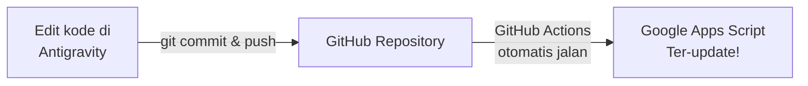

# Panduan CI/CD GitHub & Google Apps Script (Clasp)

Dengan setup ini, Anda bisa:
1. **Mengedit kode langsung di Antigravity**.
2. **Push kode langsung dari Antigravity** ke Google Apps Script tanpa buka browser (`npm run push`).
3. **Deploy otomatis via GitHub Actions** setiap kali Anda melakukan `git push` ke GitHub!

---

## 🛠️ Persiapan (Hanya Sekali di Awal)

### Langkah 1: Aktifkan Google Apps Script API
Google mewajibkan izin akses API untuk alat deploy otomatis (clasp):
1. Buka browser dan pergi ke: **https://script.google.com/home/usersettings**
2. Pada bagian **Google Apps Script API**, ubah tombol menjadi **ON**.

---

### Langkah 2: Ambil Script ID dari Project Anda
1. Buka project Apps Script Anda di browser: https://script.google.com
2. Klik menu **Project Settings** (ikon gear ⚙️ di sebelah kiri).
3. Cari **Script ID**, lalu salin (copy) ID tersebut.
   *(Contoh: `1B74u47-XYZ123456789...`)*
4. Buka file [`.clasp.json`](file:///C:/Users/Cirilusyulian/.gemini/antigravity/brain/7f11ab94-5b21-4b99-8f6e-841b877c4c22/scratch/kk-katolik-gas/.clasp.json) di folder ini, ganti `YOUR_SCRIPT_ID_HERE` dengan ID yang tadi Anda salin.

---

### Langkah 3: Login Clasp di Komputer Anda
Jalankan perintah ini di terminal Antigravity / CMD di dalam folder project:

```bash
cmd /c "npx @google/clasp login"
```

Browser akan terbuka otomatis:
1. Pilih akun Google Anda.
2. Klik **Allow / Izinkan**.
3. Terminal akan menampilkan: `Logged in! You may close this page.`
4. File kredensial login Anda akan tersimpan di komputer Anda di `C:\Users\Cirilusyulian\.clasprc.json`.

---

### Langkah 4: Tes Push Langsung dari Antigravity!
Coba jalankan perintah berikut:

```bash
cmd /c "npx @google/clasp push"
```

Jika berhasil, semua file (`Code.gs`, `DataService.gs`, `Utils.gs`, `index.html`) langsung terunggah ke Google Apps Script tanpa perlu buka web editor lagi!

---

## 🚀 Setup Otomatisasi GitHub CI/CD (GitHub Actions)

Jika Anda ingin setiap `git push` ke GitHub otomatis meng-update Google Apps Script:

### 1. Inisialisasi Git & Push ke GitHub
Di terminal Antigravity:
```bash
git init
git add .
git commit -m "feat: initial commit KK Katolik"
git branch -M main
git remote add origin https://github.com/USERNAME_ANDA/NAMA_REPO_ANDA.git
git push -u origin main
```

### 2. Tambahkan 2 Secrets di Repository GitHub
Buka repository Anda di GitHub:
1. Masuk ke **Settings** > **Secrets and variables** > **Actions**.
2. Klik **New repository secret**:

| Nama Secret | Isi Secret |
|---|---|
| `SCRIPT_ID` | Masukkan **Script ID** project Apps Script Anda |
| `CLASPRC_JSON` | Buka file `C:\Users\Cirilusyulian\.clasprc.json` dengan text editor (Notepad), salin **seluruh isinya** dan paste di sini |

3. Klik **Add secret**.

---

## ✨ Alur Kerja Sehari-hari

Sekarang alur kerja Anda menjadi sangat cepat dan praktis:



Atau jika ingin update instan dari terminal Antigravity tanpa lewat GitHub:
```bash
cmd /c "npx @google/clasp push"
```
